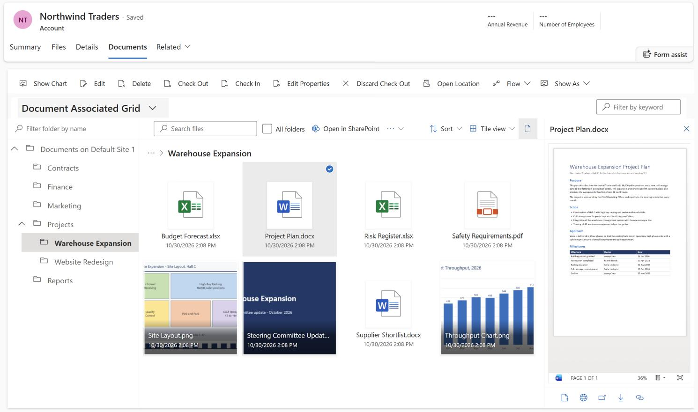

# SharePoint Full File Explorer PCF Control

A control for model-driven apps that shows SharePoint documents the way Windows Explorer shows files: the folder tree on the left and the files on the right, with search, previews and file actions.

| I want to… | Go to |
| --- | --- |
| Try it quickly | [Quick start](#quick-start) |
| Install it step by step, upgrade or remove it | [Installation guide](/installation-guide.md) |
| Choose the settings | [Configuration](#configuration) |
| Learn how to use it, or share instructions with users | [User guide](/docs/user-guide.md) |
| Solve a problem | [Troubleshooting](#troubleshooting) and [Known limitations](#known-limitations) |
| See what changed | [Changelog](/CHANGELOG.md) |
| Build or change the control | [Contributing](/CONTRIBUTING.md) |

## Features

- Folder tree, with a filter to find folders by name.
- Three view types: tiles, list and compact list. Sorting by the columns of the view works in all of them.
- Search in the current folder or in all folders of the record.
- Preview pane: Word, Excel, PowerPoint and Visio files are shown with Office for the web, other files as a preview image.
- File actions: open in the browser or in the desktop app, download, copy link and open in SharePoint.
- Optional thumbnails on the tiles.
- Optional upload by drag and drop (experimental).
- Fast folder navigation: folders opened before are shown immediately and refreshed in the background.
- Layout for phones and narrow forms.
- User interface in 14 languages.
- The standard commands, filters and view selector of the grid keep working.

The [user guide](/docs/user-guide.md) describes each of them.

## Requirements

- **App type:** model-driven apps. Power Pages does not support React controls, which this control has been since version 0.0.4.
- **SharePoint:** the standard SharePoint integration of Dataverse, [set up](https://learn.microsoft.com/en-us/power-platform/admin/set-up-dynamics-365-online-to-use-sharepoint-online) for your environment. The control has been tested with SharePoint Online.
- **Document management:** [enabled](https://learn.microsoft.com/en-us/power-platform/admin/enable-sharepoint-document-management-specific-entities) for every table on which you want to use the control.
- **No extras:** the control needs no app registration, and it is not a premium component.

The control shows the records of the **SharePoint Document** (`sharepointdocument`) table and does not connect to SharePoint by itself to list files. Before you install it, check that the standard **Documents** tab of a record shows the files. If it does not, the control will not show them either.

## Quick start

1. Download [the solution](https://github.com/ilia-sokolov/PCF-SPFileExplorer/raw/master/Solution/SPFullFileExplorer.zip "SharePoint Full File Explorer solution") and [import it into your environment](https://learn.microsoft.com/en-us/power-apps/maker/data-platform/import-update-export-solutions "How to import solution article").
2. Open a form, select a documents subgrid (related table **Documents (Regarding)**) and add the **SharePoint Full File Explorer** component to it.
3. Click **Save and Publish**, then open a record.

The [installation guide](/installation-guide.md) has the detailed steps, including how to use the control on the standard **Documents** tab of all tables.

## Configuration

Set the following properties when you add the control to a view or to a documents subgrid. The control reuses the columns, sorting and filters of its view.

| Property | Default | Works in | Since | Description |
| --- | --- | --- | --- | --- |
| **Minimum Height** | `350` | All grids | 0.0.2 | Minimum height of the control in pixels. Increase it if the control is rendered too small on a form tab. |
| **Hide folder tree** | `No` | All grids | 0.0.2 | Hides the folder tree on the left side. |
| **Default view** | `Tile view` | All grids | 0.0.3 | View type (tile, list or compact list) that is shown when the control is opened. |
| **Remember selected view** | `Yes` | All grids | 0.0.3 | Remembers the view type selected by a user in the browser and reuses it for other records. Set it to `No` to always open the **Default view**. |
| **Show thumbnails** | `No` | All grids | 0.0.5 | Shows preview images on the tiles instead of file icons. See [Thumbnails and previews](#thumbnails-and-previews). |
| **Enable drag and drop upload (experimental)** | `No` | Documents of a record | 0.0.4 | Allows users to upload files to the current folder by dragging them onto the control. See [Drag and drop upload](#drag-and-drop-upload). |

**Documents of a record** means a documents subgrid on a form or the related **Documents** tab, not a table view of all documents. Searching **All folders** is available there too.

### Thumbnails and previews

SharePoint renders the preview images for images, videos, PDF, text and Office files (`_layouts/15/getpreview.ashx`). Word, Excel, PowerPoint and Visio files open in the preview pane with Office for the web (`_layouts/15/WopiFrame.aspx`, embedded view).

Both are loaded by the browser directly from SharePoint, with the user's SharePoint session, so they depend on two things:

- **Third-party cookies:** the user must be signed in to SharePoint, and the browser must not block third-party cookies for the SharePoint domain. Otherwise the file icon is shown instead of the image, and the full preview stays empty.
- **Content security policy:** if [content security policy](https://learn.microsoft.com/en-us/power-platform/admin/content-security-policy) is enforced for model-driven apps in your environment, allow the SharePoint domain of your organization (for example `https://contoso.sharepoint.com`) in `img-src` and `frame-src`.

### Drag and drop upload

The upload uses the `UploadDocument` action of Dataverse, which the standard **Documents** grid uses for its **Upload** command. The action is not publicly documented, so it may change without notice. Test the upload in your environment before enabling it for users, and disable the property if it stops working.

## Security and privacy

- **Permissions:** the control reads documents and folders through Dataverse with the permissions of the signed-in user. Previews and links open in SharePoint with the user's own session, so users only see files they have access to in SharePoint.
- **Connections:** the browser connects to Dataverse, to your SharePoint site and, for the file type icons, to the Microsoft Fluent UI CDN. The control uses no other external service, no Microsoft Graph and no stored credentials.
- **Browser storage:** the selected view type, the tile size and whether the preview pane is open are kept in the browser's local storage. No file data is stored there.

## Troubleshooting

**The standard grid is still shown instead of the control.**
Check that the control is listed under **Components** of the view or the subgrid for all client types (Web, Mobile and Tablet) and that the view or the form was published. On a form, add the control to the documents subgrid itself (see the [installation guide](/installation-guide.md#2-add-the-control-to-a-form)).

**"There are no documents to show" is displayed.**
No active SharePoint document location was found for the record. Check that document management is enabled for the table and open the standard **Documents** tab once, so that the document location and the SharePoint folder are created.

**Folders are not shown, all files of all subfolders are listed together.**
The control shows whatever the view returns. If the view filter contains the condition **Is Recursive Fetch** equals **Yes**, files of all subfolders are returned as a flat list and folders are not returned. Edit the view used by the control and remove this condition (or set it to **No**).

**Thumbnails or preview images are not shown, or the full preview is blank.**
They need the user's SharePoint session and third-party cookies. Open SharePoint once in the same browser, and check the browser's cookie settings and your [content security policy](#thumbnails-and-previews). Preview images are available for images, videos, PDF, text and Office files, the full preview for Word, Excel, PowerPoint and Visio files.

**"The search failed" is displayed.**
The text after the colon comes from Dataverse. Searching **All folders** reads the documents of the record through the same SharePoint connection as the **Documents** tab, so first check that the tab shows the files. Searching the current folder keeps working, because it only filters the files that are already loaded.

**Open in desktop app does nothing, or the option is missing.**
The desktop app has to be installed, and the browser may ask for permission to open it. The option is shown for Word, Excel, PowerPoint, Visio and Project files only.

**Uploaded files, or the folder tree, belong to another document location.**
See the first item of [Known limitations](#known-limitations).

**Files cannot be dropped onto the control.**
Check that **Enable drag and drop upload (experimental)** is set and that the control shows the documents of a record; in a table view of all documents there is no record to upload the files to.

**The control is rendered too small on a form tab.**
Increase the **Minimum Height** property of the control.

## Known limitations

- **Several document locations on one record:** Dataverse returns an empty location ID for documents, so the control cannot tell which location is selected under **Document Location**. The grid shows the files of the selected location, but the folder tree, links, previews, **All folders** search and upload use the record's oldest active location.
- **Number of documents:** the control loads up to 5,000 documents of the current folder.
- **All folders search:** it compares file names only (not the content), loads up to 5,000 documents of the record and shows up to 500 results.
- **Large folder hierarchies:** the folder tree is requested with one query per folder and refreshed at most once per minute, so very large hierarchies take longer to load.
- **Drag and drop upload:** it is experimental (see [Drag and drop upload](#drag-and-drop-upload)) and does not upload folders.
- **Folders opened before:** they are shown from the browser memory until their content is reloaded, which usually takes less than a second.

## License

The control is distributed under the [MIT License](/LICENSE).
