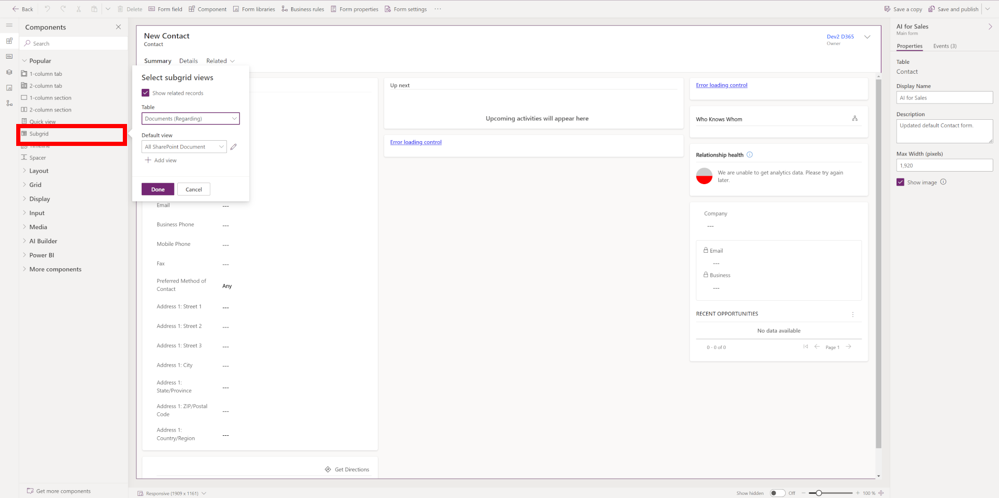
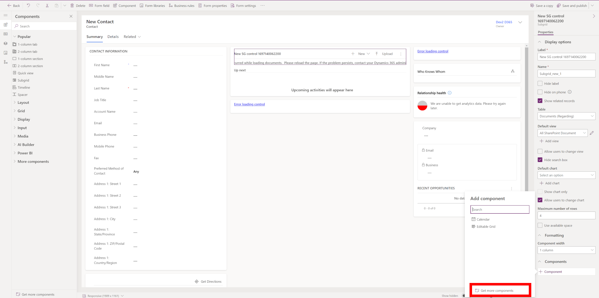
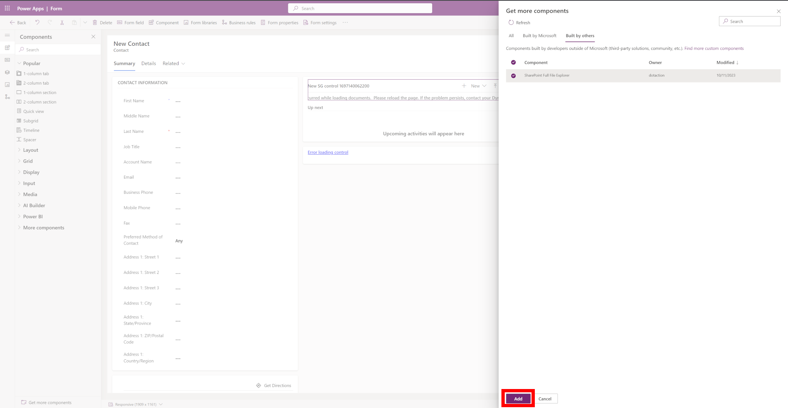
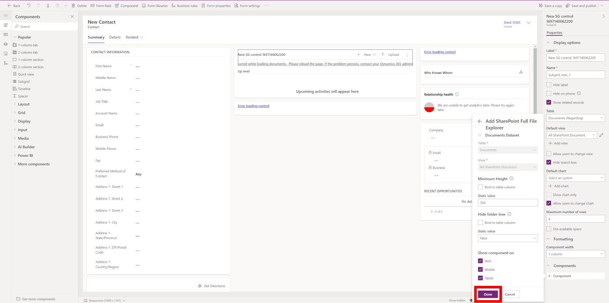
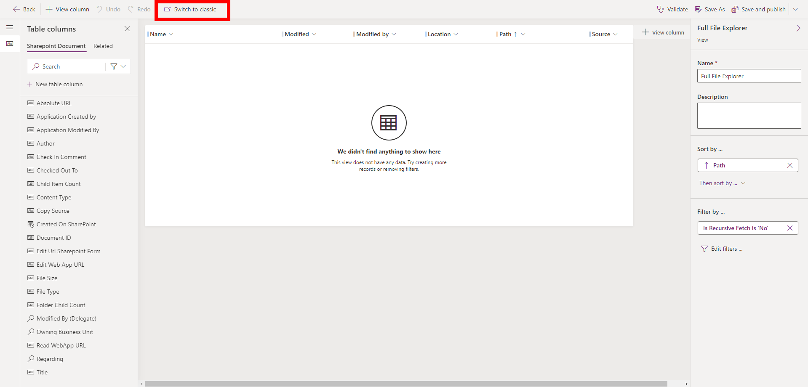
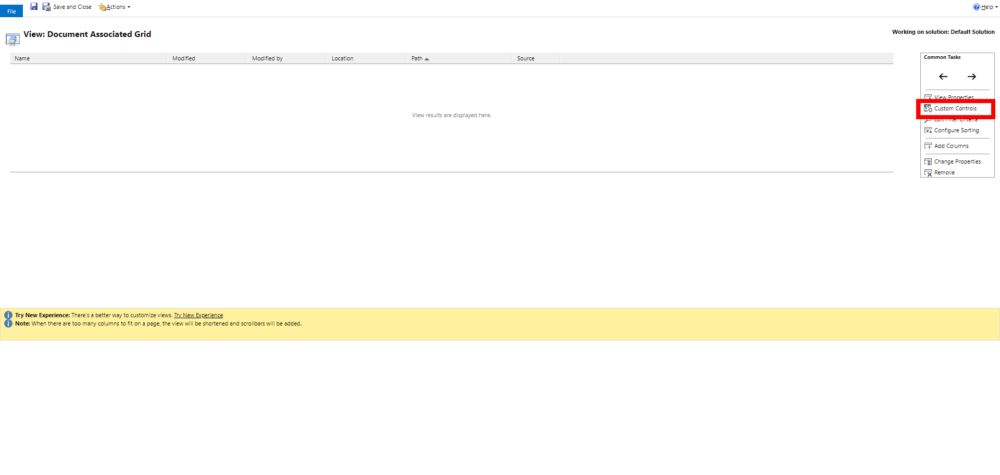
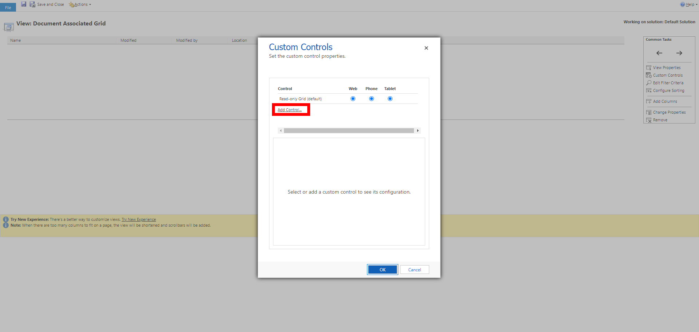
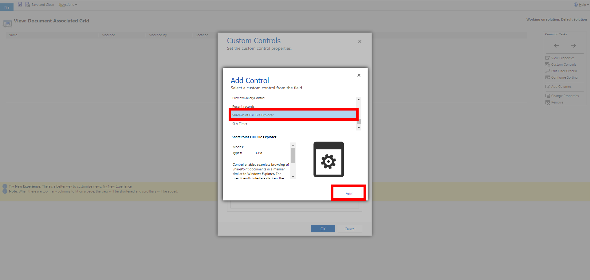
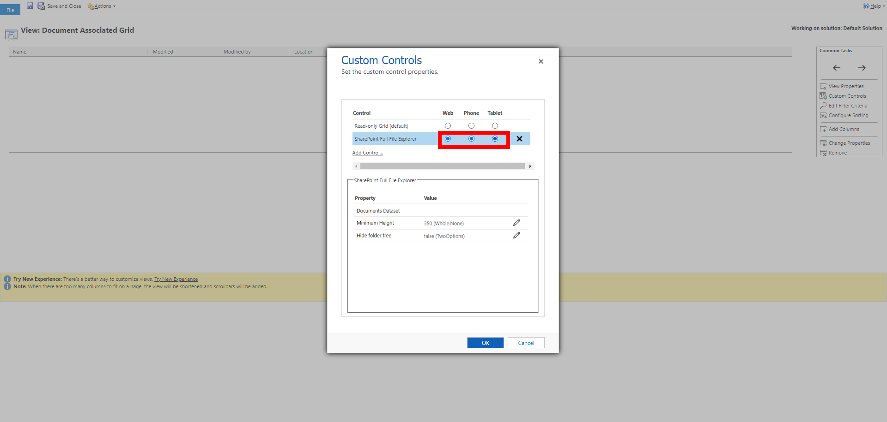

# How to install the control

1. [Import the solution](#1-import-the-solution).
2. Choose where to show the control:
   - [On a form](#2-add-the-control-to-a-form): a documents subgrid on the forms you choose.
   - [On the Documents tab or a table view](#3-add-the-control-to-a-view): the view you choose, for every place that shows it.
3. [Check that it works](#4-check-that-it-works).

Later, you may need to [upgrade](#upgrade-the-control) or [remove](#switch-back-or-remove-the-control) the control.

Before you start, check the [requirements](/README.md#requirements). The designers call the control a *component*: **SharePoint Full File Explorer** is the name to look for.

## 1. Import the solution

1. Download [the solution](https://github.com/ilia-sokolov/PCF-SPFileExplorer/raw/master/Solution/SPFullFileExplorer.zip "SharePoint Full File Explorer solution").
2. [Import it into your environment](https://learn.microsoft.com/en-us/power-apps/maker/data-platform/import-update-export-solutions "How to import solution article"). It is a managed solution and contains only the control.

## 2. Add the control to a form

Use this when the control should replace the documents on specific forms. On a form, all features are available, including upload and **All folders** search.

1. Open the solution that contains the form, go to the table and open **Forms**.
2. Select the form that you want to modify and click **Edit**.
3. Add a new documents subgrid (related table **Documents (Regarding)**) or select an existing one.
   
4. Click **Component** in the **Components** section of the properties and click **Get more components**.
   
5. In the **Built by others** tab, select the **SharePoint Full File Explorer** component and click **Add**.
   
6. Configure the [properties of the control](/README.md#configuration) and click **Done**. If the control is rendered too small on the tab, increase **Minimum Height**.
   
7. Click **Save and Publish**.

> **Tip:** Use a view whose filter does not contain the condition **Is Recursive Fetch** equals **Yes**, otherwise folders are not shown and the files of all subfolders are listed together.

## 3. Add the control to a view

Use this to set the control on a view of the **SharePoint Document** table. The view decides where the control appears:

- **Document Associated Grid** is the view of the related **Documents** tab, so the control is shown on that tab for all tables.
- Other views show the control wherever they are used. A table view of all documents has no record, so upload and **All folders** search are not available there.

These steps use the classic view editor. The modern designer has a **Components** command as well, but it has not been tested with this control.

1. Open the **Default Solution** and go to the **SharePoint Document** table.
2. Go to **Views**, select the view and click **Edit**.
3. Click **Switch to classic**.
   
4. In the **Common Tasks** section, click **Custom Controls**.
   
5. In the popup, click **Add Control**.
   
6. From the list, select the **SharePoint Full File Explorer** control and click **Add**.
   
7. Choose **Web**, **Phone** and **Tablet** to use this control as the default for all client types. Optionally, configure the [properties of the control](/README.md#configuration) and click **OK**.
   
8. Click **Save and Close**.
9. Go back to the view and click **Save and Publish**.

## 4. Check that it works

Open a record with documents, or the view, and refresh the page. You should see the folder tree on the left and the files on the right. Open a folder, then select a file and click the **Preview** button on the right side of the command bar.

If something is missing, see [Troubleshooting](/README.md#troubleshooting).

## Upgrade the control

1. Download the new solution and import it in the same way. Your views and forms keep the control and its settings.
2. Refresh the browser so that the new version is loaded.

Properties added by the new version start with their default values. Check the [changelog](/CHANGELOG.md) for new properties that you may want to set.

## Switch back or remove the control

To show the standard grid again:

- **On a form:** select the subgrid, delete the control in the **Components** section of its properties, and click **Save and Publish**.
- **On a view:** open **Custom Controls** in the classic view editor as described above, delete the control, and click **Save and Publish**.

To remove the control from the environment, first switch back on all forms and views, then delete the solution.
